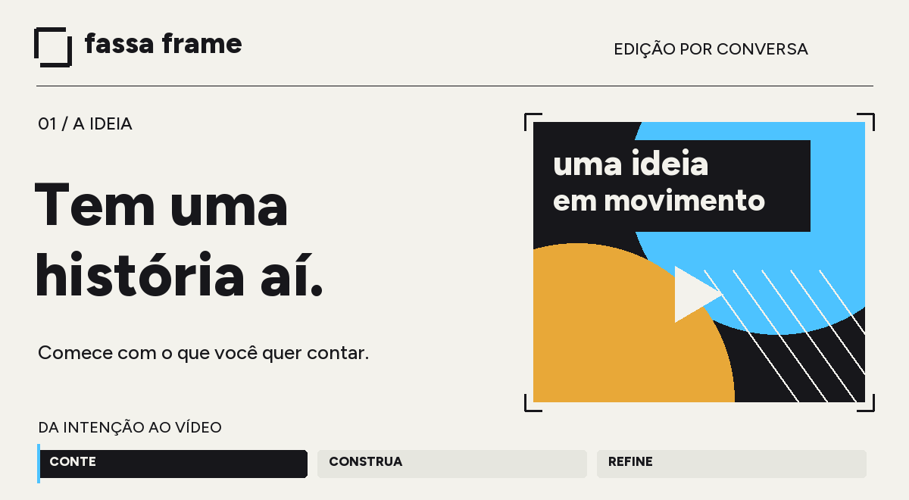

<a href="docs/assets/readme/fassa-frame-poster.png">Ver capa sem animação</a>

<strong>Conte o que você quer comunicar. Construa o vídeo conversando.</strong> Para marketing, comunicação, treinamento e quem tem uma boa história para contar.

<a href="docs/getting-started.md">Começar aqui</a> · <a href="docs/examples.md">Pedidos prontos</a> · <a href="docs/updates.md">Como atualizar</a> · <a href="NOTICE.md">De onde veio</a>

  
  
  
  

---

## Você traz a ideia. A Fassa Frame ajuda na edição.

Você tem uma gravação, uma mensagem e um público. A Fassa Frame ajuda seu assistente de IA a transformar isso em uma edição: escolher trechos, organizar a sequência, criar legendas, ajustar som e revisar o resultado.

Ela funciona dentro do **Codex ou do Claude Code**, no seu computador. É um conjunto de instruções e ferramentas para esses assistentes — uma *skill*. Você conversa com o assistente e recebe arquivos de vídeo para assistir e aprovar. **Não é um aplicativo de arrastar e soltar, nem um serviço que publica vídeos sozinho.**

> “Use a Fassa Frame. Quero transformar esta entrevista em um vídeo de até um minuto para o LinkedIn. O público são gestores. Preserve o sentido das falas, use legendas grandes e me mostre uma primeira versão.”

## O que dá para fazer

| Você precisa de… | Pode pedir assim |
| --- | --- |
| Um vídeo curto para redes sociais | “Encontre a melhor história nesta gravação e monte um vídeo vertical.” |
| Uma apresentação de produto | “Organize estes takes para mostrar o problema, a solução e a chamada final.” |
| Um treinamento mais claro | “Divida esta aula em capítulos e destaque os passos importantes.” |
| Uma explicação visual | “Mostre estes números com textos grandes e gráficos simples.” |
| Ajustar uma edição aprovada | “Aumente as legendas. Mantenha os cortes, a voz e a música.” |

[Copiar um pedido completo →](docs/examples.md)

## Um caminho simples, em quatro passos

**01 · Conte a intenção**  
Diga para quem é o vídeo, onde vai aparecer e o que a pessoa deve entender ou fazer.

**02 · Separe o material**  
Indique uma pasta com suas gravações, imagens e identidade visual. Use materiais que você pode utilizar.

**03 · Veja uma primeira versão**  
O assistente prepara a edição e confere o arquivo. Você assiste: a mensagem ficou clara? O texto dá para ler no celular? A voz soa natural?

**04 · Peça ajustes específicos**  
A versão anterior fica guardada. Mudanças pontuais devem preservar o que já foi aprovado.

## Primeira vez? Comece por aqui

Você precisa ter acesso a este repositório e usar Codex ou Claude Code com acesso a arquivos locais. A instalação exige algumas ferramentas no computador; seu assistente ou alguém da equipe técnica pode preparar isso uma vez.

Copie este pedido no seu assistente:

> Quero instalar a Fassa Frame deste repositório: `https://github.com/marcoantoniofassa/fassa-frame`. Leia o README e `docs/installation.md`, confira os requisitos e instale para o assistente que estou usando. Preserve instalações existentes, não altere meus projetos e avise se faltar acesso ou alguma dependência. Depois, confira se a skill está disponível.

**Já instalou?** Abra uma nova conversa, escreva “Use a Fassa Frame” e descreva o vídeo. No Codex, você também pode selecionar `$fassa-frame`; no Claude Code, `/fassa-frame`.

[Guia para a primeira edição →](docs/getting-started.md) · [Instalação técnica →](docs/installation.md)

## O que esta versão entrega — e o que depende de você

- **Edição local:** cortes, legendas, composição, áudio e ferramentas de conferência. Alguns recursos baixam dependências ou modelos na primeira execução.
- **Seu material, seu projeto:** as gravações e os resultados ficam fora da pasta da ferramenta. O repositório não contém vídeos de clientes nem conversas privadas.
- **Geração de voz, imagem ou música:** opcional. Depende de um serviço conectado, autorização e possíveis custos. A Fassa Frame não inclui créditos nem garante uma voz específica em toda instalação.
- **Biblioteca visual:** inclui cenas editáveis e recursos com licença documentada. Vídeos, músicas e imagens herdados sem comprovação individual de redistribuição ficaram fora desta edição. Cenas que dependam deles precisam de material próprio ou autorizado. [Detalhes →](docs/distribution.md)
- **Revisão humana:** as ferramentas ajudam a conferir o arquivo; você continua responsável por assistir, ouvir e aprovar antes de compartilhar.

A primeira distribuição é **0.1.0**, voltada a testes acompanhados. Veja [o que foi verificado](docs/release-validation.md). Não promete funcionar igualmente em todo computador.

## Uma ferramenta que evolui junto com o uso

Este repositório concentra as versões, os guias e as melhorias. Assim, a equipe não precisa trocar pastas soltas nem adivinhar qual cópia está atualizada.

[Novidades por versão](CHANGELOG.md) · [Atualizar com segurança](docs/updates.md) · [Relatar um problema](https://github.com/marcoantoniofassa/fassa-frame/issues/new/choose)

Ao relatar um problema, descreva o resultado esperado e o que aconteceu. **Não anexe material de cliente, conversas ou credenciais.** Um exemplo fictício normalmente basta.

## Um remix com crédito a quem construiu antes

Fassa Frame parte do **[Editonny, criado por Matheus Gomes](https://github.com/soumatheusgomes/editonny)**, e incorpora adaptações e aprendizados de uso de Marco Fassa. A base, os autores e as licenças continuam identificados. O foco deste remix é editar conforme a intenção, preservar decisões aprovadas e facilitar a revisão por quem usa o vídeo.

Código sob [licença MIT](LICENSE.md). Leia também [autoria e atribuição](NOTICE.md) e [licenças dos recursos de terceiros](skills/editonny/engine/THIRD_PARTY_NOTICES.md). As licenças de imagens, fontes, modelos e áudio continuam próprias de cada recurso.

<strong>Para quem vai instalar, manter ou contribuir</strong>

- [Instalação e recuperação](docs/installation.md)
- [Preparação para divulgação](docs/public-launch.md)
- [Hospedagem do guia](docs/hosting.md)
- [Arquitetura](docs/architecture.md)
- [Origem e atualização da base](docs/upstream.md)
- [Como contribuir](CONTRIBUTING.md)
- [Verificações desta distribuição](docs/release-validation.md)
- [Skill principal](skills/editonny/SKILL.md)

Os nomes internos `editonny` foram preservados para compatibilidade. O nome para usar com o assistente é **Fassa Frame**.

